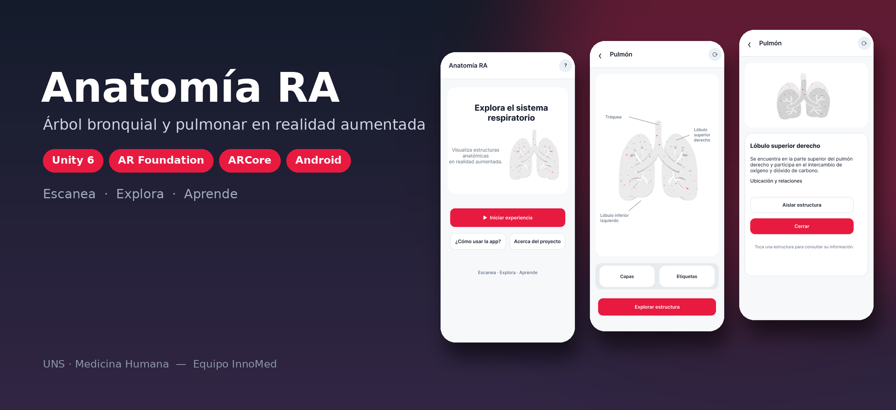
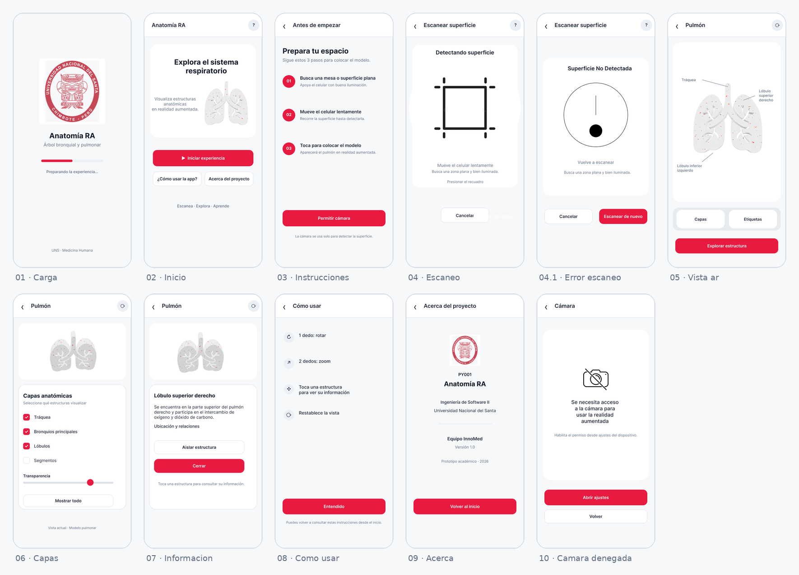
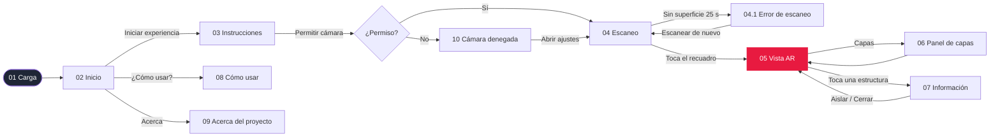
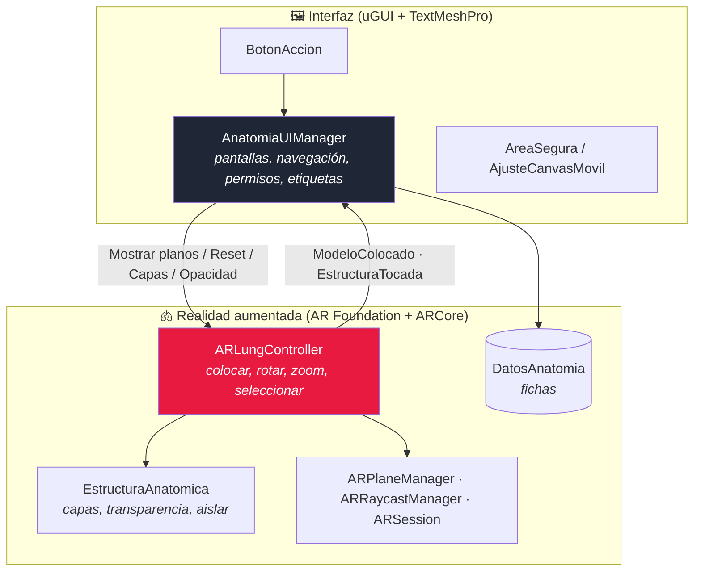

<div align="center">



# 🫁 Anatomía RA

**Aplicación móvil de realidad aumentada para aprender la anatomía del árbol bronquial y los pulmones.**
Coloca un pulmón 3D sobre tu mesa, gíralo, acércalo y toca cada estructura para conocerla.

<br/>

[](https://unity.com/)
[](https://learn.microsoft.com/dotnet/csharp/)
[](https://docs.unity3d.com/Packages/com.unity.xr.arfoundation@6.0/manual/index.html)
[](https://developers.google.com/ar)
[](https://www.android.com/)

[](https://unity.com/srp/universal-render-pipeline)
[](https://docs.unity3d.com/Packages/com.unity.inputsystem@1.20/manual/index.html)
[](https://www.figma.com/)
[](https://www.blender.org/)
[](ROADMAP.md)
[](#-equipo)

[Características](#-características) ·
[Pantallas](#-pantallas) ·
[Tecnologías](#-tecnologías) ·
[Arquitectura](#-arquitectura) ·
[Instalación](#-instalación-y-compilación) ·
[Roadmap](ROADMAP.md)

</div>

---

## 📖 Sobre el proyecto

**Anatomía RA** (código **PY001**) es un prototipo académico desarrollado por el **Equipo InnoMed** para el curso de **Ingeniería de Software II** de la **Universidad Nacional del Santa (UNS)**, orientado a estudiantes de **Medicina Humana**.

Estudiar anatomía en láminas 2D hace difícil entender la forma real y las relaciones entre estructuras. Con esta app, el estudiante apunta el celular a una mesa, coloca un **modelo 3D del pulmón en realidad aumentada** y lo explora desde cualquier ángulo: rota, hace zoom, oculta capas, aísla estructuras y lee la ficha anatómica de cada parte.

> **Escanea · Explora · Aprende**

## ✨ Características

| | Funcionalidad | Descripción |
|:-:|---|---|
| 📷 | **Detección de superficies** | Encuentra mesas y pisos con ARCore y muestra el recuadro donde colocar el modelo. |
| 🫁 | **Pulmón 3D en RA** | Modelo con texturas PBR que se ajusta solo a ~30 cm y mira hacia la cámara. |
| ☝️ | **Gestos táctiles** | 1 dedo para rotar · 2 dedos para hacer zoom · toque corto para seleccionar. |
| 🏷️ | **Etiquetas anatómicas** | Tráquea, lóbulo superior derecho, lóbulo inferior izquierdo… siguen al modelo en pantalla. |
| 🧩 | **Capas anatómicas** | Muestra u oculta tráquea, bronquios, lóbulos y segmentos. |
| 🔍 | **Transparencia** | Control deslizante para ver a través del modelo. |
| 📚 | **Fichas de información** | Descripción y "ubicación y relaciones" de 7 estructuras, con opción de **aislarlas**. |
| ⟳ | **Restablecer vista** | Devuelve el modelo a su posición y tamaño iniciales. |
| 🔒 | **Permisos claros** | Flujo de permiso de cámara con pantalla de "cámara denegada" y acceso directo a Ajustes. |
| 📱 | **Diseño adaptable** | Interfaz fiel a Figma (390 × 844) que se adapta a cualquier celular y respeta la muesca. |

## 📱 Pantallas

Diseñadas en **Figma** e implementadas en Unity con uGUI + TextMeshPro (11 pantallas):

<div align="center">

</div>

<details>
<summary><b>Ver el flujo de navegación</b></summary>



</details>

## 🛠️ Tecnologías

### Motor y lenguaje

| Tecnología | Versión | Uso en el proyecto |
|---|---|---|
|  **Unity** | 6.6 (`6000.6.7f1`) | Motor principal, editor y compilación |
|  **C#** | .NET / Mono · IL2CPP | Toda la lógica de la app y del editor |

### Realidad aumentada

| Paquete | Versión | Uso |
|---|---|---|
| **AR Foundation** (`com.unity.xr.arfoundation`) | 6.6.2 | Sesión AR, planos, raycasts y fondo de cámara |
| **Google ARCore XR Plugin** (`com.unity.xr.arcore`) | 6.6.2 | Proveedor de RA en Android |
| **XR Plug-in Management** | incluido | Carga de ARCore (Android) y XR Simulation (editor) |
| **XR Simulation** | incluido | Probar la RA dentro del editor de Unity |

### Render, entrada e interfaz

| Paquete | Versión | Uso |
|---|---|---|
| **Universal Render Pipeline (URP)** | 17.6.0 | Render móvil, *AR Background Renderer Feature*, MSAA 4x |
| **Input System** (`EnhancedTouch`) | 1.20.1 | Gestos táctiles: rotar, pellizcar y tocar |
| **uGUI** + **TextMeshPro** | 2.6.0 | Las 11 pantallas, botones, casillas, slider y etiquetas |
| **UI Toolkit Figma Importer** (`com.unity.ui.figma`) | 1.0.0-pre.1 | Conexión del proyecto con el diseño de Figma |
| **Android JNI** | módulo | Permisos de cámara y acceso a Ajustes del sistema |

### Diseño y contenido 3D

| Herramienta | Uso |
|---|---|
|  **Figma** | Prototipo frontend de las 11 pantallas, colores y tipografía (Inter) |
|  **Blender** | Modelado y preparación del pulmón (`pulmon_vfinal.blend`) |
| **FBX** + texturas **PBR** | Base color, normal, roughness, metalness, AO y height (2 piezas: vía aérea y pulmones) |

### Plataforma y herramientas

| Herramienta | Uso |
|---|---|
|  **Android** 8.0+ (API 26) | Plataforma de destino · IL2CPP · ARM64 · OpenGL ES 3 |
| **Android SDK / NDK / JDK / Gradle** | Compilación del APK desde Unity |
|  **VS Code** · Visual Studio · Rider | Edición de scripts C# |
|  **Git** +  **GitHub** | Control de versiones |
|  **Claude** (Anthropic) | Asistente de IA para implementar la interfaz y conectarla con la RA |

### Paleta de diseño

| Color | Hex | Uso |
|---|---|---|
|  | `#E81A40` | Botones principales, acentos |
|  | `#141C2B` | Títulos |
|  | `#1F2636` | Texto |
|  | `#616E80` | Texto secundario |
|  | `#DBE0E8` | Bordes |
|  | `#F6F8FA` | Fondo |

## 🧱 Arquitectura



| Script | Responsabilidad |
|---|---|
| [`ARLungController.cs`](Assets/Scripts/ARLungController.cs) | Coloca el pulmón sobre el plano tocado, lo escala a 30 cm, gestiona rotación, zoom, selección por toque, capas, transparencia y aislamiento. |
| [`AnatomiaUIManager.cs`](Assets/Scripts/AnatomiaRA/AnatomiaUIManager.cs) | Navegación entre las 11 pantallas, permiso de cámara, ciclo de la sesión AR, etiquetas sobre el modelo y avisos. |
| [`EstructuraAnatomica.cs`](Assets/Scripts/AnatomiaRA/EstructuraAnatomica.cs) | Marca cada pieza del modelo: tipo, capas, materiales transparentes y detección del lóbulo tocado. |
| [`DatosAnatomia.cs`](Assets/Scripts/AnatomiaRA/DatosAnatomia.cs) | Textos de las fichas: tráquea, bronquios y los 5 lóbulos. |
| [`BotonAccion.cs`](Assets/Scripts/AnatomiaRA/BotonAccion.cs) | Asocia cada botón del diseño con una acción. |
| [`AreaSegura.cs`](Assets/Scripts/AnatomiaRA/AreaSegura.cs) · [`AjusteCanvasMovil.cs`](Assets/Scripts/AnatomiaRA/AjusteCanvasMovil.cs) | Adaptación a muescas y a distintas proporciones de pantalla. |
| [`ConstructorUIAnatomiaRA.cs`](Assets/Editor/ConstructorUIAnatomiaRA.cs) | Herramienta de editor: genera toda la interfaz desde el diseño de Figma, prepara el modelo y configura URP para RA. |

<details>
<summary><b>📁 Estructura del repositorio</b></summary>

```
AnatomiaRA/
├── Assets/
│   ├── AnatomiaRA/          # Sprites (Figma + generados) y materiales transparentes
│   ├── Editor/              # ConstructorUIAnatomiaRA.cs (menú "Anatomía RA")
│   ├── Models/              # Pulmón FBX, prefabs AR, materiales y texturas PBR
│   ├── Scenes/              # SampleScene.unity (escena principal)
│   ├── Scripts/             # ARLungController + AnatomiaRA/*
│   ├── Settings/            # URP (Mobile/PC), perfil de build Android
│   ├── TextMesh Pro/        # Fuentes y shaders de TMP
│   └── XR/                  # ARCore, XR Simulation, XR Management
├── Packages/                # manifest.json y packages-lock.json
├── ProjectSettings/         # Configuración del proyecto Unity
├── docs/                    # Banner y capturas para este README
├── README.md
└── ROADMAP.md
```

</details>

## 🚀 Instalación y compilación

### Requisitos

- **Unity 6.6** (`6000.6.7f1`) con el módulo **Android Build Support** (SDK, NDK y OpenJDK)
- Celular **Android 8.0+** compatible con **ARCore** ([lista oficial](https://developers.google.com/ar/devices)) y con *Google Play Services for AR*

### Pasos

```bash
git clone https://github.com/DevonFerrer/AnatomiaRA.git
```

1. Abre la carpeta en **Unity Hub** → *Add project from disk*. La primera vez Unity reconstruye `Library/` (tarda unos minutos).
2. Abre `Assets/Scenes/SampleScene.unity`.
3. *(Opcional)* Menú **Anatomía RA → Construir interfaz en la escena** para regenerar la UI, y **Anatomía RA → Arreglar cámara AR** si la cámara se ve de un color sólido.
4. **File → Build Profiles → Android → Build** (o *Build And Run* con el celular conectado por USB).

### Probar en el editor

Con **XR Simulation** activado (Project Settings → XR Plug-in Management → pestaña PC), pulsa **Play**. El mouse funciona como dedo; mantén el **clic derecho + W A S D** para moverte por el entorno simulado.

### Uso de la app

| Gesto | Acción |
|---|---|
| ☝️ Arrastrar | Rotar el pulmón |
| 🤏 Pellizcar | Zoom |
| 👆 Toque corto | Abrir la ficha de la estructura |
| ⟳ | Restablecer la vista |

## 🗺️ Roadmap

El plan completo, con fases y estado, está en **[ROADMAP.md](ROADMAP.md)**.

- [x] Prototipo frontend en Figma (11 pantallas)
- [x] Modelo 3D del pulmón con texturas PBR
- [x] RA con AR Foundation + ARCore y gestos táctiles
- [x] Interfaz completa conectada al modelo
- [ ] Pruebas en varios dispositivos Android
- [ ] Separar el modelo en lóbulos y segmentos reales
- [ ] Modo cuestionario y más estructuras anatómicas

## 👥 Equipo

<div align="center">

| **Equipo InnoMed** |
|:-:|
| Proyecto **PY001** · Ingeniería de Software II |
| **Universidad Nacional del Santa** — Chimbote, Perú |
| Dirigido a la Escuela de **Medicina Humana** |
| Versión **1.0** · Prototipo académico · 2026 |

</div>

---

<div align="center">
<sub>Hecho con 🫁 y ☕ por el Equipo InnoMed · UNS 2026</sub>
</div>
