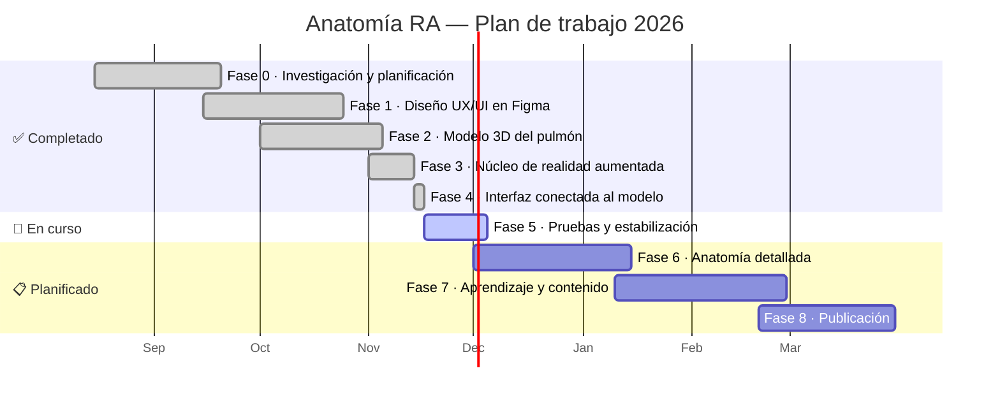

# 🗺️ Roadmap — Anatomía RA

**Plan de desarrollo del prototipo de realidad aumentada para anatomía pulmonar**

✅ Completado · 🚧 En curso · 📋 Planificado

---

## 📅 Línea de tiempo

---

## ✅ Fase 0 — Investigación y planificación
> Definir el problema, el alcance y el equipo.

- [x] Realidad problemática: dificultad de aprender anatomía 3D con láminas 2D
- [x] Acta de constitución del proyecto PY001 (Equipo InnoMed)
- [x] Justificación, épicas y backlog priorizado
- [x] Elección de tecnologías: **Unity 6 + AR Foundation + ARCore**
- [x] Planificación por sprints y burndown

## ✅ Fase 1 — Diseño UX/UI en Figma
> Prototipo frontend "Anatomía RA — Prototipo Frontend".

- [x] Sistema visual: paleta `#E81A40` / `#1F2636` / `#F6F8FA`, tipografía Inter
- [x] 11 pantallas: carga, inicio, instrucciones, escaneo, error de escaneo, vista RA, capas, información, cómo usar, acerca de, cámara denegada
- [x] Flujo de navegación y estados (con y sin etiquetas, fichas por estructura)
- [x] Componentes reutilizables: botones, casillas, selector Capas/Etiquetas

## ✅ Fase 2 — Modelo 3D del pulmón
> Contenido anatómico listo para tiempo real.

- [x] Modelo en **Blender** (`pulmon_vfinal.blend`)
- [x] Exportación a **FBX** con 2 piezas: vía aérea (tráquea + bronquios) y pulmones
- [x] Texturas **PBR**: base color, normal, roughness, metalness, AO y height
- [x] Materiales URP Lit y prefab `Lungs With Texture`

## ✅ Fase 3 — Núcleo de realidad aumentada
> Que el pulmón aparezca sobre una mesa real.

- [x] Proyecto Unity 6 con URP para móvil y perfil de build Android
- [x] AR Foundation 6.6 + Google ARCore XR Plugin 6.6
- [x] XR Origin, AR Session, detección de planos y raycasts
- [x] Colocación del modelo con un toque
- [x] Gestos con el **Input System** (`EnhancedTouch`): rotar y hacer zoom
- [x] XR Simulation para probar en el editor

## ✅ Fase 4 — Interfaz conectada al modelo
> Llevar el diseño de Figma a Unity y unirlo con la RA.

- [x] Constructor de interfaz automático (menú **Anatomía RA**) con las 11 pantallas
- [x] `AnatomiaUIManager`: navegación, botón "atrás" de Android y avisos
- [x] Flujo de permiso de cámara y pantalla de "cámara denegada" con acceso a Ajustes
- [x] Escaneo con tiempo límite y pantalla de error
- [x] Ajuste automático del modelo a 30 cm, centrado y mirando a la cámara
- [x] Etiquetas anatómicas que siguen al modelo
- [x] Panel de capas (tráquea, bronquios, lóbulos, segmentos) y transparencia
- [x] Fichas de 7 estructuras con **Aislar estructura**
- [x] Interfaz adaptable a cualquier pantalla y respetando la muesca
- [x] Corrección del fondo de cámara (*AR Background Renderer Feature*), nitidez (Render Scale 1, MSAA 4x)

## 🚧 Fase 5 — Pruebas y estabilización
> Asegurar que funciona bien en celulares reales.

- [x] Primer APK de prueba (IL2CPP · ARM64)
- [ ] Probar en al menos 3 celulares ARCore de gama baja, media y alta
- [ ] Medir FPS y temperatura; optimizar texturas normales (12–14 MB) y el FBX (30 MB)
- [ ] Ajustar tamaño inicial, iluminación y sombra de contacto del modelo
- [ ] Pruebas de usabilidad con estudiantes de Medicina Humana
- [ ] Corregir hallazgos y publicar la versión **1.1**

## 📋 Fase 6 — Anatomía detallada
> Que cada capa y cada lóbulo sea una pieza real del modelo.

- [ ] Separar en Blender: tráquea, bronquios principales, lóbulos (3 derechos, 2 izquierdos) y segmentos broncopulmonares
- [ ] Una `EstructuraAnatomica` por pieza (selección y capas exactas)
- [ ] Resaltar la estructura seleccionada
- [ ] Vista en corte y animación de la respiración (inspiración / espiración)
- [ ] Revisión del contenido por un docente de anatomía

## 📋 Fase 7 — Aprendizaje y contenido
> Pasar de explorar a aprender.

- [ ] Modo **cuestionario**: "toca el lóbulo medio derecho"
- [ ] Narración en audio de cada ficha
- [ ] Más órganos del sistema respiratorio (laringe, diafragma, pleura)
- [ ] Soporte de idiomas (español / inglés) con Unity Localization
- [ ] Fuente **Inter** del diseño original y modo oscuro

## 📋 Fase 8 — Publicación
> Llegar a los estudiantes.

- [ ] Ícono, nombre y pantalla de inicio definitivos
- [ ] Firma con keystore y build **AAB**
- [ ] Ficha en **Google Play** (prueba interna → abierta)
- [ ] Política de privacidad (uso de cámara)
- [ ] Presentación final del proyecto PY001

---

## 🧩 Hitos

| Hito | Descripción | Estado |
|---|---|:-:|
| **M1** | Prototipo en Figma aprobado | ✅ |
| **M2** | Pulmón visible en RA sobre una mesa | ✅ |
| **M3** | App completa con la interfaz del diseño (v1.0) | ✅ |
| **M4** | Validada en dispositivos y con estudiantes (v1.1) | 🚧 |
| **M5** | Anatomía por lóbulos y segmentos (v2.0) | 📋 |
| **M6** | Publicada en Google Play | 📋 |

Equipo InnoMed · Universidad Nacional del Santa · 2026

